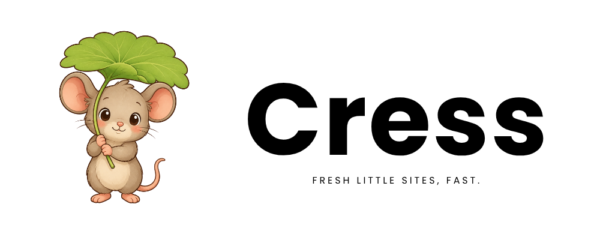

# Cress



Cress is an open-source static site generator for small businesses and
solopreneurs. It turns Markdown content, a TOML configuration file, and a
theme into static website files. [Cozy Badger](https://www.cozybadger.de)
builds Cress; you deploy the files with your hosting tools.

## Getting started

[Install Cress](docs/INSTALL.md), then create and preview a site:

```sh
cress site init my-site
cress site preview --port 0 my-site
```

Open the printed URL. Edit `my-site/content/` and `my-site/cress.toml`,
then refresh the browser. Stop preview with Ctrl-C.
Run `cress site build my-site` to produce `my-site/public/`.
Deploy those files with your hosting tools.

The [user guide](docs/USER.md) explains how to write a page, configure a site,
preview it, and build its files.

## What Cress provides

- Ordinary pages, landing pages, and journal-style lists.
- Markdown content with page-owned images and shared static files.
- Captions, heading links, and syntax highlighting without raw HTML.
- Drafts that stay out of published builds.
- Links that work at any deployment path, plus a sitemap and search engine
  metadata.
- Three accessible themes without JavaScript, for freelancers, small
  businesses, and makers.
- English and German theme text.
- Local theme packages, explicit navigation, and automatic preview rebuilds.

The [product requirements](docs/PRD.md#scope) define the scope.

## Documentation

Guides:

- [User guide](docs/USER.md): create, write, preview, and publish a site.
- [Installation guide](docs/INSTALL.md): download and verify Cress.
- [Content guide](docs/CONTENT.md): write good pages in Markdown.
- [Theme developer guide](docs/THEMES.md): build your own theme.
- [Accessibility guide](docs/ACCESSIBILITY.md): what Cress takes care of and
  how to write accessible content.
- [Developer guide](docs/DEVELOPER.md): set up, build, and test the source.
- [Release guide](docs/RELEASE.md): check, tag, and publish a release.

Reference documents:

- [Build and preview document](docs/OUTPUT.md): preview, output protection,
  and recovery.
- [Product requirements document](docs/PRD.md): scope and acceptance
  criteria.
- [Architecture document](docs/ARCHITECTURE.md): system boundary,
  responsibilities, and data flow.
- [Architectural decision records](docs/adr/): accepted decisions and their
  rationale, listed in the [decision index](docs/PRD.md#decision-records).

## Contributing

Open an [issue](https://github.com/cozybadgerde/cress/issues) for ideas,
questions, or bug reports. Before opening a pull request with code changes,
open an issue so we can agree on the approach. The
[developer guide](docs/DEVELOPER.md) covers setup and checks.

## Contact

Contact the project maintainers:

- Website: [cozybadger.de](https://www.cozybadger.de)
- Email: [devel@cozybadger.de](mailto:devel@cozybadger.de)
- GitHub: [cozybadgerde](https://github.com/cozybadgerde)

## License

Cress's code is licensed under [BSD-3-Clause](LICENSE). The
[project artwork](docs/assets/logo/README.md) is copyright Daniel Schier
and licensed under CC BY-SA 4.0 International. Bundled dependencies retain
their own licenses. Releases include dependency notices and license reports.
See the [licensing decision](docs/adr/0011-bsd-3-clause-license.md).
